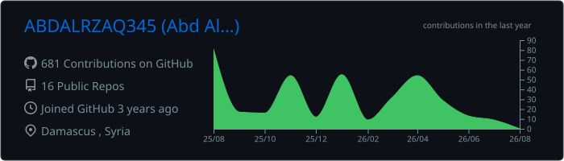
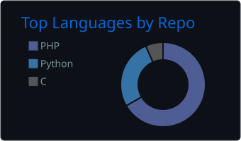
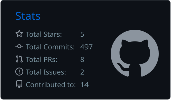

<h1 align="center"><samp>Hi 👋, I'm Abd Alrzaq Najieb</samp></h1>

  

  
  
  
  
  

<h3 align="center">👨‍💻 About Me</h3>

<ul>
  <li>💻 <strong>Backend Engineer</strong> focused on designing robust, high-performance APIs and scalable architectures.</li>
  <li>🎓 <strong>5th-Year AI Student</strong> at Damascus University, bridging software engineering with machine learning principles.</li>
  <li>⚡ <strong>Competitive Programmer</strong> with over <strong>2,000+</strong> problems solved across Codeforces, LeetCode, and AtCoder.</li>
  <li>📍 <strong>Location:</strong> Damascus, Syria.</li>
</ul>

<h3 align="center">🛠️ Languages & Technologies</h3>

#### Programming Languages

  

#### Backend Development

  

#### Infrastructure & DevOps

  

#### Tools & Testing

  

  

<h3 align="center">📊 GitHub & Competitive Programming Stats</h3>

  

  

  
  

---

<h4 align="center">Open to collaboration, learning, and challenges</h4>
